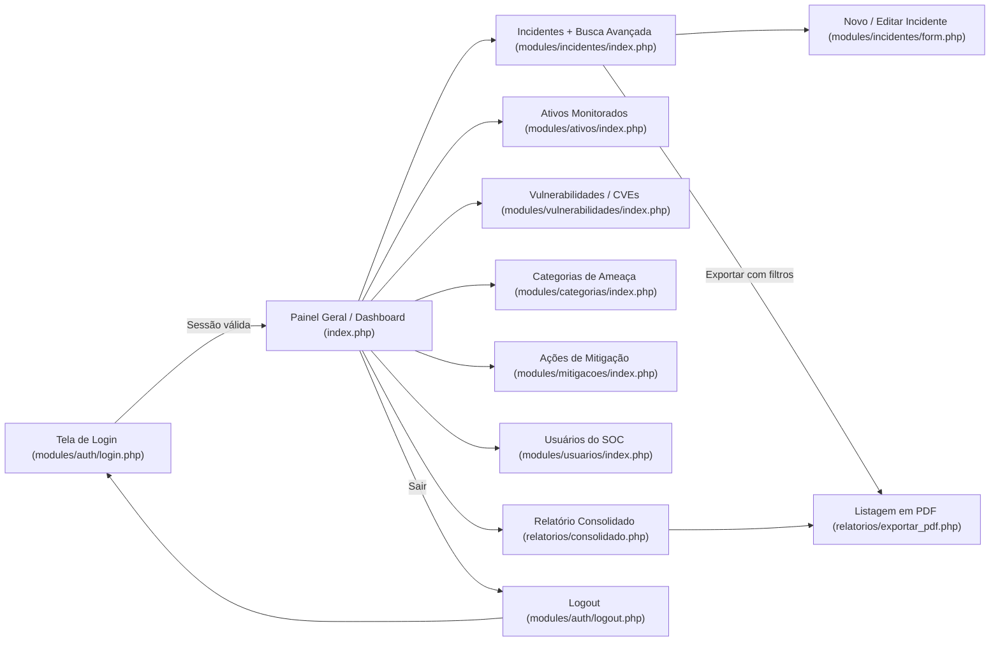
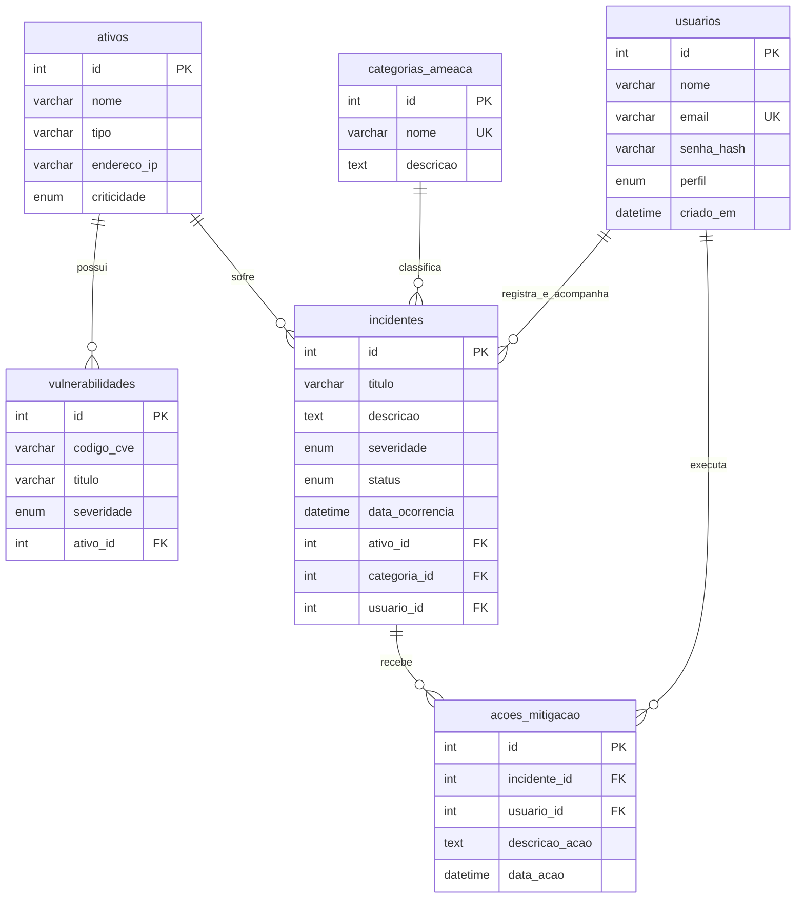

# Documentação Completa do Projeto — Trabalho A3

**Sistema:** Mini-SOC — Sistema de Gestão de Incidentes de Cibersegurança e Vulnerabilidades  
**Tecnologias:** PHP 8+ (PDO / Estruturado Modular), MySQL / MariaDB (InnoDB), Bootstrap 5.3, Bootstrap Icons 1.11 e Exportação PDF (`MiniFPDF` / `FPDF`)

---

## Sumário

1. [Visão Geral e Atendimento aos Requisitos (Trabalho A3)](#1-visão-geral-e-atendimento-aos-requisitos-trabalho-a3)
2. [Descrição e Justificativa do Domínio de Informações](#2-descrição-e-justificativa-do-domínio-de-informações)
3. [Histórias de Usuário](#3-histórias-de-usuário)
4. [Protótipo das Telas e Fluxo de Navegação](#4-protótipo-das-telas-e-fluxo-de-navegação)
5. [Modelo Entidade-Relacionamento (MER)](#5-modelo-entidade-relacionamento-mer)
6. [Esquema e Dicionário de Banco de Dados](#6-esquema-e-dicionário-de-banco-de-dados)
7. [Arquitetura, Segurança e Boas Práticas Implementadas](#7-arquitetura-segurança-e-boas-práticas-implementadas)
8. [Instruções de Instalação e Configuração](#8-instruções-de-instalação-e-configuração)
9. [Manual de Utilização do Sistema](#9-manual-de-utilização-do-sistema)

---

## 1. Visão Geral e Atendimento aos Requisitos (Trabalho A3)

O **Mini-SOC** é um sistema web acadêmico desenvolvido em **PHP 8+ com PDO**, **MySQL/MariaDB (InnoDB)** e **Bootstrap 5** que simula a rotina operacional de um pequeno Centro de Operações de Segurança (*Security Operations Center*). O sistema centraliza o registro, a triagem, a busca avançada, a mitigação e a geração de relatórios gerenciais sobre incidentes de cibersegurança e vulnerabilidades conhecidas (CVEs).

### Matriz de Atendimento aos Critérios do Trabalho A3

| Requisito do Enunciado | Implementação no Projeto | Referência no Código |
| :--- | :--- | :--- |
| **Domínio com 6 tipos de informações relacionadas** | 6 entidades integradas por chaves estrangeiras: `usuarios`, `ativos`, `categorias_ameaca`, `vulnerabilidades`, `incidentes` e `acoes_mitigacao`. | `sql/01_schema.sql` |
| **CRUD completo em PHP (Create, Read, Update, Delete)** | Operações completas de criação, listagem, edição e exclusão para todas as 6 entidades, com tratamento amigável de restrições de chave estrangeira. | `modules/*/{index,form,excluir}.php` |
| **Autenticação com Sessão e Segurança** | Login validado por `password_verify()` (hash `bcrypt`), cookie `HttpOnly` e `SameSite=Lax`, `session_regenerate_id(true)`, middleware `exigir_login()` em todas as páginas internas e logout seguro. | `config/auth.php`, `modules/auth/{login,logout}.php` |
| **Busca Avançada (mínimo 3 filtros de tipos diferentes)** | 4 filtros combináveis de **3 tipos distintos**: **texto livre** (título do incidente ou IP do ativo via `LIKE`), **seleção categórica/ENUM** (severidade e status) e **intervalo temporal** (data inicial e data final). | `modules/incidentes/index.php` |
| **Relatório consolidado** | Painel gerencial com totalizadores SQL (`COUNT`, `GROUP BY`, `LEFT JOIN`) por severidade, status, ativos mais afetados, CVEs por ativo e categorias de ameaça. | `relatorios/consolidado.php` |
| **Listagem emitida em PDF** | Geração de relatório em PDF (A4 Paisagem) respeitando exatamente os filtros aplicados na tela de incidentes, com cabeçalho, rodapé e totalizador. | `relatorios/exportar_pdf.php`, `lib/MiniFPDF.php` |
| **Scripts de banco de dados (DDL + carga inicial)** | Script de criação do banco, tabelas, chaves estrangeiras e índices + script de carga inicial realista e reexecutável. | `sql/01_schema.sql`, `sql/02_seed.sql` |
| **Utilização do Bootstrap** | Interface responsiva em tema escuro minimalista utilizando Bootstrap 5.3.3 (grid, cards, tabelas responsivas, badges, alertas, formulários e barra de navegação) e Bootstrap Icons. | `includes/header.php`, `assets/css/style.css` |
| **Documentação completa** | Descrição do domínio, histórias de usuário, protótipo, MER, dicionário de dados, instruções de instalação e manual de uso reunidos neste documento. | `docs/DOCUMENTACAO_COMPLETA.md` |

---

## 2. Descrição e Justificativa do Domínio de Informações

### 2.1 Contextualização e Justificativa

Equipes de Tecnologia da Informação e Segurança da Informação lidam diariamente com alertas de intrusão, falhas conhecidas em softwares (CVEs) e ataques direcionados a servidores web, bancos de dados, firewalls e estações de trabalho. Quando esses registros ficam dispersos em planilhas ou e-mails, perde-se a rastreabilidade sobre:

- quais incidentes críticos ainda estão abertos ou em análise;
- quais ativos da infraestrutura concentram mais ocorrências e vulnerabilidades;
- qual analista é responsável por cada investigação;
- quais ações de contenção já foram aplicadas em cada incidente.

A escolha do domínio de **Gestão de Incidentes de Cibersegurança e Vulnerabilidades (Mini-SOC)** justifica-se por sua aderência direta à área de Tecnologia da Informação, pela riqueza de relacionamentos entre entidades reais e pela necessidade natural de filtros combinados, controle de acesso por sessão e relatórios consolidados para tomada de decisão.

### 2.2 As 6 Entidades Relacionadas do Domínio

1. **Usuários (`usuarios`)**: analistas e administradores autenticados no sistema, responsáveis pela abertura, investigação e mitigação dos incidentes.
2. **Ativos Monitorados (`ativos`)**: inventário dos equipamentos e serviços protegidos pelo SOC (servidores, firewalls, controladores de domínio e estações), identificados por tipo, endereço IP e criticidade.
3. **Categorias de Ameaça (`categorias_ameaca`)**: taxonomia padronizada dos vetores de ataque (Phishing, Força Bruta, Injeção SQL, Malware/Ransomware, DDoS e Escalação de Privilégio).
4. **Vulnerabilidades (`vulnerabilidades`)**: catálogo de falhas conhecidas identificadas por código CVE e severidade, sempre associadas a um ativo monitorado.
5. **Incidentes (`incidentes`)**: entidade central do domínio, que registra cada evento de segurança com título, descrição técnica, severidade, status do ciclo de vida (*Aberto*, *Em Análise*, *Contido*, *Resolvido*), data/hora da ocorrência, ativo afetado, categoria de ameaça e analista responsável.
6. **Ações de Mitigação (`acoes_mitigacao`)**: histórico auditável das medidas técnicas de contenção, erradicação e recuperação aplicadas por um analista em um incidente específico.

---

## 3. Histórias de Usuário

As 10 histórias abaixo descrevem os fluxos funcionais essenciais do sistema **Mini-SOC**, sob a perspectiva dos perfis envolvidos (Analista de Segurança, Analista de Vulnerabilidades, Administrador e Gestor do SOC):

| ID | História de Usuário | Critério Principal de Aceite |
| :--- | :--- | :--- |
| **HU01** | **Como** analista de segurança, **quero** realizar login com e-mail e senha validados por sessão, **para** acessar o painel do Mini-SOC com segurança e proteger os registros contra acessos não autorizados. | Validar credenciais via `password_verify()`, regenerar o ID de sessão e redirecionar páginas protegidas para o login quando não autenticado. |
| **HU02** | **Como** analista de segurança, **quero** encerrar minha sessão através do botão de logout, **para** garantir que minha conta não permaneça aberta em estações compartilhadas. | Limpar variáveis de sessão, invalidar o cookie de sessão e redirecionar para a tela de login com mensagem de confirmação. |
| **HU03** | **Como** administrador do SOC, **quero** cadastrar, editar e remover ativos monitorados (nome, tipo, IP e criticidade), **para** manter o inventário atualizado dos servidores e equipamentos protegidos. | Permitir CRUD completo em `ativos` e bloquear exclusão com mensagem amigável caso haja incidentes ou CVEs vinculadas. |
| **HU04** | **Como** analista de segurança, **quero** gerenciar categorias de ameaça (como Phishing, Força Bruta e Injeção SQL), **para** padronizar a classificação dos ataques registrados no sistema. | Garantir unicidade do nome da categoria e impedir remoção caso esteja vinculada a incidentes existentes. |
| **HU05** | **Como** analista de vulnerabilidades, **quero** cadastrar CVEs associadas a ativos específicos e sua severidade, **para** rastrear quais equipamentos possuem falhas conhecidas que precisam de correção. | Vincular cada CVE a um ativo existente via chave estrangeira e permitir consulta/edição/exclusão pelo módulo dedicado. |
| **HU06** | **Como** analista de segurança, **quero** registrar novos incidentes vinculando ativo, categoria, severidade, status e data da ocorrência, **para** documentar formalmente cada evento suspeito identificado. | Validar campos obrigatórios no servidor, persistir via PDO Prepared Statements e exibir alerta flash de sucesso. |
| **HU07** | **Como** analista de segurança, **quero** atualizar o status e os detalhes de um incidente existente, **para** refletir o avanço da investigação de *Aberto* até *Resolvido*. | Carregar os dados atuais no formulário de edição e atualizar o registro preservando os vínculos existentes. |
| **HU08** | **Como** analista de segurança, **quero** filtrar incidentes combinando texto (título ou IP do ativo), severidade, status e intervalo de datas, **para** localizar rapidamente eventos específicos durante uma investigação. | Aplicar filtros combináveis dinamicamente via `WHERE 1=1` com parâmetros preparados e preservar os filtros na interface. |
| **HU09** | **Como** analista de resposta a incidentes, **quero** registrar ações de mitigação vinculadas a cada incidente, **para** manter um histórico auditável de todas as medidas de contenção executadas. | Associar cada ação a um incidente e a um analista com data/hora, removendo em cascata apenas se o incidente pai for excluído. |
| **HU10** | **Como** gestor do SOC, **quero** visualizar um relatório consolidado com totais por severidade, status e ativos mais afetados, além de exportar a listagem filtrada de incidentes em PDF, **para** acompanhar indicadores e apresentar evidências em reuniões gerenciais. | Exibir agregações SQL (`COUNT` e `GROUP BY`) em tela e emitir PDF válido contendo exatamente os registros dos filtros ativos. |

---

## 4. Protótipo das Telas e Fluxo de Navegação

### 4.1 Fluxo de Navegação da Aplicação



### 4.2 Wireframes das Telas Principais

A interface foi projetada com **Bootstrap 5.3 (`data-bs-theme="dark"`)**, layout responsivo (`container-xl`, `row`/`col-*`, `table-responsive`), barra de navegação fixa no topo (`navbar sticky-top`), cartões de indicadores (KPIs) e *badges* coloridos por severidade e status.

#### Tela 1 — Autenticação (`modules/auth/login.php`)

```text
+-----------------------------------------------------------------------+
|                                                                       |
|                     +-----------------------------------+             |
|                     |            [ Escudo ]             |             |
|                     |             Mini-SOC              |             |
|                     | Gestão de Incidentes e Vulns.     |             |
|                     |                                   |             |
|                     |  E-mail corporativo               |             |
|                     |  [ admin@minisoc.local          ] |             |
|                     |                                   |             |
|                     |  Senha                            |             |
|                     |  [ ••••••••••••                 ] |             |
|                     |                                   |             |
|                     |  [      Entrar no Painel       ]  |             |
|                     |  -------------------------------  |             |
|                     |  Acesso de demonstração:          |             |
|                     |  admin@minisoc.local / Admin@123  |             |
|                     +-----------------------------------+             |
|                                                                       |
+-----------------------------------------------------------------------+
```

- **Componentes Bootstrap:** `card`, `form-control`, `btn btn-light w-100`, `alert alert-danger` (erros de autenticação).

#### Tela 2 — Painel Geral / Dashboard (`index.php`)

```text
+-----------------------------------------------------------------------+
| [Mini-SOC] Painel | Incidentes | Ativos | Vulns | Cat. | Mit. | Rel.  |
|                                           Administrador SOC  [ Sair ] |
+-----------------------------------------------------------------------+
| Painel de Operações de Segurança     [+ Novo Incidente] [Relatório]   |
|                                                                       |
| +---------------+ +---------------+ +---------------+ +-------------+ |
| | TOTAL INCID.  | | ABERTO/ANÁL.  | | SEV. CRÍTICA  | | ATIVOS/CVEs | |
| |      12       | |       5       | |       4       | |  6 / 8 CVEs | |
| +---------------+ +---------------+ +---------------+ +-------------+ |
|                                                                       |
| +-------------------------------------------------------------------+ |
| | Incidentes Recentes                                 [ Ver todos ] | |
| +----+------------------------+--------------+--------+------+------+ |
| | #  | Incidente              | Ativo / IP   | Sev.   | Stat | Data | |
| +----+------------------------+--------------+--------+------+------+ |
| | 12 | Indisponibilidade...   | SRV-WEB-01   | [Alta] | Aber | 18/03| |
| | 11 | Detecção de dropper... | SRV-MAIL-01  | [Méd.] | Res. | 14/03| |
| +----+------------------------+--------------+--------+------+------+ |
+-----------------------------------------------------------------------+
```

- **Componentes Bootstrap:** `navbar-expand-lg`, `row g-3`, cards de KPI (`col-6 col-lg-3`), `table-responsive`, `badge rounded-pill`.

#### Tela 3 — Listagem de Incidentes com Busca Avançada e PDF (`modules/incidentes/index.php`)

```text
+-----------------------------------------------------------------------+
| Incidentes de Segurança          [ Exportar PDF ]  [+ Novo Incidente] |
+-----------------------------------------------------------------------+
| [ BUSCA AVANÇADA ]                                                    |
| Texto (Título ou IP)        Severidade     Status                     |
| [ SQL ou 192.168...      ] [ Todas    v ] [ Todos      v ]            |
| Data Inicial               Data Final                                 |
| [ 01/02/2026             ] [ 31/03/2026 ] [ Filtrar ] [ Limpar ]      |
+-----------------------------------------------------------------------+
| Resultados encontrados: 12 registro(s)                                |
| +----+-------------------+-------------+----------+--------+--------+ |
| | #  | Título            | Ativo / IP  | Sev/Stat | Mitig. | Ações  | |
| +----+-------------------+-------------+----------+--------+--------+ |
| | #1 | SQL Injection...  | SRV-WEB-01  | Crít/Con |   2    | Ed|Ex  | |
| | #6 | Consultas mass... | SRV-DB-01   | Crít/Abe |   0    | Ed|Ex  | |
| +----+-------------------+-------------+----------+--------+--------+ |
+-----------------------------------------------------------------------+
```

- **Destaque funcional:** os parâmetros ativos do formulário de busca (`GET`) são propagados automaticamente para o link do botão **Exportar PDF**, garantindo que o PDF reflita exatamente a filtragem exibida em tela.

#### Tela 4 — Formulário de Cadastro/Edição de Incidente (`modules/incidentes/form.php`)

```text
+-----------------------------------------------------------------------+
| Novo / Editar Incidente                                    [ Voltar ] |
+-----------------------------------------------------------------------+
| Título do Incidente *                                                 |
| [ Tentativa de SQL Injection no módulo de login                     ] |
|                                                                       |
| Descrição Técnica / Evidências *                                      |
| [ WAF registrou 47 requisições contendo payloads UNION SELECT...    ] |
|                                                                       |
| Ativo Afetado *               Categoria de Ameaça *                   |
| [ SRV-WEB-01 (192.168.10.10)v] [ Injeção SQL                     v ]  |
|                                                                       |
| Severidade *       Status *           Analista *         Data/Hora *  |
| [ Crítica      v ] [ Contido      v ] [ Lucas Mendes v ] [2026-02-04] |
|                                                                       |
|                                      [ Cancelar ]  [ Salvar Incidente]|
+-----------------------------------------------------------------------+
```

- **Telas auxiliares:** os módulos de **Ativos**, **Vulnerabilidades**, **Categorias**, **Mitigações** e **Usuários** seguem o mesmo padrão visual consistente (tabela responsiva com busca/contagem + formulário validado em card centralizado + confirmação de exclusão).

#### Tela 5 — Relatório Consolidado (`relatorios/consolidado.php`)

```text
+-----------------------------------------------------------------------+
| Relatório Consolidado de Segurança    [ Exportar PDF ] [ Busca Avanç.]|
+-----------------------------------------------------------------------+
| [ Total: 12 ] [ Críticos/Altos: 9 ] [ Pendentes: 5 ] [ Resolução: 41%]|
+-----------------------------------+-----------------------------------+
| Incidentes por Severidade         | Incidentes por Status             |
| Crítica  | 4 | [========    ] 33% | Aberto     | 3 | [======    ] 25% |
| Alta     | 5 | [==========  ] 42% | Em Análise | 2 | [====      ] 17% |
| Média    | 2 | [====        ] 17% | Contido    | 2 | [====      ] 17% |
| Baixa    | 1 | [==          ]  8% | Resolvido  | 5 | [==========] 42% |
+-----------------------------------+-----------------------------------+
| Ativos com Mais Ocorrências (IP, Criticidade, CVEs, Incidentes)       |
| + Tabela por Categoria de Ameaça                                      |
+-----------------------------------------------------------------------+
```

---

## 5. Modelo Entidade-Relacionamento (MER)

O diagrama abaixo apresenta as 6 entidades do banco de dados `mini_soc`, seus atributos, chaves primárias (`PK`), chaves estrangeiras (`FK`), chaves únicas (`UK`) e relacionamentos implementados em `sql/01_schema.sql`:



### Resumo dos Relacionamentos e Integridade Referencial

| Relacionamento | Cardinalidade | Chave Estrangeira | Regra `ON DELETE` / `ON UPDATE` | Regra de Negócio |
| :--- | :---: | :--- | :--- | :--- |
| `ativos` -> `vulnerabilidades` | **1 : N** | `vulnerabilidades.ativo_id` | `RESTRICT` / `CASCADE` | Um ativo pode possuir várias CVEs; não pode ser excluído se houver CVEs associadas. |
| `ativos` -> `incidentes` | **1 : N** | `incidentes.ativo_id` | `RESTRICT` / `CASCADE` | Um ativo pode sofrer vários incidentes; impede exclusão de ativo com histórico de incidentes. |
| `categorias_ameaca` -> `incidentes` | **1 : N** | `incidentes.categoria_id` | `RESTRICT` / `CASCADE` | Uma categoria classifica vários incidentes; impede remoção de categoria em uso. |
| `usuarios` -> `incidentes` | **1 : N** | `incidentes.usuario_id` | `RESTRICT` / `CASCADE` | Um analista pode acompanhar vários incidentes; preserva a autoria/rastreabilidade. |
| `incidentes` -> `acoes_mitigacao` | **1 : N** | `acoes_mitigacao.incidente_id` | `CASCADE` / `CASCADE` | Um incidente recebe várias ações de mitigação; ao excluir o incidente, suas ações são removidas automaticamente. |
| `usuarios` -> `acoes_mitigacao` | **1 : N** | `acoes_mitigacao.usuario_id` | `RESTRICT` / `CASCADE` | Um analista pode registrar diversas ações de mitigação; preserva o histórico de execução. |

---

## 6. Esquema e Dicionário de Banco de Dados

- **Banco de Dados:** `mini_soc`
- **SGBD / Engine:** MySQL 5.7+ / MariaDB 10.4+ (`InnoDB`)
- **Codificação:** `utf8mb4` / Collation `utf8mb4_unicode_ci`
- **Scripts SQL:** `sql/01_schema.sql` (DDL) e `sql/02_seed.sql` (carga inicial)

### 6.1 Tabela `usuarios`
Armazena os analistas e administradores autorizados a acessar o sistema.

| Campo | Tipo | Restrições | Nulo | Padrão | Descrição |
| :--- | :--- | :--- | :---: | :--- | :--- |
| `id` | `INT` | `PK`, `AUTO_INCREMENT` | Não | — | Identificador único do usuário. |
| `nome` | `VARCHAR(100)` | — | Não | — | Nome completo do usuário. |
| `email` | `VARCHAR(120)` | `UNIQUE` | Não | — | E-mail utilizado para autenticação (login). |
| `senha_hash` | `VARCHAR(255)` | — | Não | — | Hash `bcrypt` da senha gerado via `password_hash()`. |
| `perfil` | `ENUM('admin','analista')` | — | Não | `'analista'` | Perfil de acesso do usuário no SOC. |
| `criado_em` | `DATETIME` | — | Não | `CURRENT_TIMESTAMP` | Data e hora de criação do cadastro. |

### 6.2 Tabela `ativos`
Inventário de servidores, firewalls e estações de trabalho monitorados pelo SOC.

| Campo | Tipo | Restrições | Nulo | Padrão | Descrição |
| :--- | :--- | :--- | :---: | :--- | :--- |
| `id` | `INT` | `PK`, `AUTO_INCREMENT` | Não | — | Identificador único do ativo. |
| `nome` | `VARCHAR(100)` | — | Não | — | Nome/hostname descritivo do ativo. |
| `tipo` | `VARCHAR(60)` | — | Não | — | Categoria física ou lógica (ex.: Servidor Web, Firewall). |
| `endereco_ip` | `VARCHAR(45)` | `INDEX` (`idx_ativos_ip`) | Não | — | Endereço IPv4 ou IPv6 do ativo monitorado. |
| `criticidade` | `ENUM('Baixa','Media','Alta','Critica')` | — | Não | `'Media'` | Nível de importância do ativo para o negócio. |

### 6.3 Tabela `categorias_ameaca`
Taxonomia utilizada para classificar o tipo de ataque ou ameaça de cada incidente.

| Campo | Tipo | Restrições | Nulo | Padrão | Descrição |
| :--- | :--- | :--- | :---: | :--- | :--- |
| `id` | `INT` | `PK`, `AUTO_INCREMENT` | Não | — | Identificador único da categoria. |
| `nome` | `VARCHAR(80)` | `UNIQUE` | Não | — | Nome da categoria de ameaça (ex.: Phishing, Injeção SQL). |
| `descricao` | `TEXT` | — | Sim | `NULL` | Descrição detalhada da natureza da ameaça. |

### 6.4 Tabela `vulnerabilidades`
Registro de falhas de segurança conhecidas (CVEs) associadas aos ativos monitorados.

| Campo | Tipo | Restrições | Nulo | Padrão | Descrição |
| :--- | :--- | :--- | :---: | :--- | :--- |
| `id` | `INT` | `PK`, `AUTO_INCREMENT` | Não | — | Identificador único da vulnerabilidade. |
| `codigo_cve` | `VARCHAR(30)` | — | Não | — | Código padronizado da falha (ex.: `CVE-2024-3094`). |
| `titulo` | `VARCHAR(150)` | — | Não | — | Resumo técnico da vulnerabilidade. |
| `severidade` | `ENUM('Baixa','Media','Alta','Critica')` | — | Não | `'Media'` | Grau de risco atribuído à falha. |
| `ativo_id` | `INT` | `FK` (`ativos.id`) | Não | — | Referência ao ativo afetado pela vulnerabilidade. |

### 6.5 Tabela `incidentes`
Entidade principal do sistema, responsável pelo registro e triagem dos incidentes de segurança.

| Campo | Tipo | Restrições | Nulo | Padrão | Descrição |
| :--- | :--- | :--- | :---: | :--- | :--- |
| `id` | `INT` | `PK`, `AUTO_INCREMENT` | Não | — | Identificador único do incidente. |
| `titulo` | `VARCHAR(150)` | — | Não | — | Título resumido do incidente detectado. |
| `descricao` | `TEXT` | — | Não | — | Relato técnico e evidências do ocorrido. |
| `severidade` | `ENUM('Baixa','Media','Alta','Critica')` | `INDEX` (`idx_incidentes_severidade`) | Não | `'Media'` | Nível de severidade do incidente. |
| `status` | `ENUM('Aberto','Em Analise','Contido','Resolvido')` | `INDEX` (`idx_incidentes_status`) | Não | `'Aberto'` | Estágio atual do tratamento do incidente. |
| `data_ocorrencia` | `DATETIME` | `INDEX` (`idx_incidentes_data`) | Não | — | Data e hora em que o incidente foi observado. |
| `ativo_id` | `INT` | `FK` (`ativos.id`) | Não | — | Ativo de infraestrutura impactado. |
| `categoria_id` | `INT` | `FK` (`categorias_ameaca.id`) | Não | — | Categoria de ameaça associada ao incidente. |
| `usuario_id` | `INT` | `FK` (`usuarios.id`) | Não | — | Analista responsável pelo registro e acompanhamento. |

### 6.6 Tabela `acoes_mitigacao`
Histórico das ações de contenção, erradicação ou recuperação executadas em um incidente.

| Campo | Tipo | Restrições | Nulo | Padrão | Descrição |
| :--- | :--- | :--- | :---: | :--- | :--- |
| `id` | `INT` | `PK`, `AUTO_INCREMENT` | Não | — | Identificador único da ação de mitigação. |
| `incidente_id` | `INT` | `FK` (`incidentes.id`, `ON DELETE CASCADE`) | Não | — | Incidente ao qual a ação pertence. |
| `usuario_id` | `INT` | `FK` (`usuarios.id`) | Não | — | Analista que executou a ação. |
| `descricao_acao` | `TEXT` | — | Não | — | Detalhamento técnico da medida aplicada. |
| `data_acao` | `DATETIME` | — | Não | `CURRENT_TIMESTAMP` | Data e hora da execução da ação. |

### 6.7 Índices Auxiliares e Carga Inicial (`sql/02_seed.sql`)

- **Índices criados em `sql/01_schema.sql`:** `idx_incidentes_severidade`, `idx_incidentes_status`, `idx_incidentes_data` e `idx_ativos_ip`, acelerando filtros da busca avançada e consultas agregadas do relatório consolidado.
- **Massa de dados inicial (`sql/02_seed.sql`):** 3 usuários (senhas em hash `bcrypt`), 6 ativos monitorados, 6 categorias de ameaça, 8 vulnerabilidades (CVEs), 12 incidentes com datas, severidades e status distribuídos e 10 ações de mitigação. O script realiza limpeza ordenada com `DELETE FROM` e reinício de `AUTO_INCREMENT` para reimportação segura no phpMyAdmin.

---

## 7. Arquitetura, Segurança e Boas Práticas Implementadas

### 7.1 Organização de Pastas e Módulos

```text
├── assets/css/style.css           # Customizações visuais sobre o tema escuro Bootstrap 5
├── config/
│   ├── auth.php                   # Sessão, middleware de login, base_url(), helpers e badges
│   └── database.php               # Conexão PDO singleton com suporte automático às portas 3307/3306
├── docs/
│   └── DOCUMENTACAO_COMPLETA.md   # Documentação unificada do Trabalho A3
├── includes/
│   ├── header.php                 # Cabeçalho HTML, navbar responsiva e exibição de mensagens flash
│   └── footer.php                 # Rodapé e scripts JS do Bootstrap 5
├── lib/
│   └── MiniFPDF.php               # Gerador PDF 1.4 compatível com FPDF (zero dependências externas)
├── modules/
│   ├── auth/                      # Autenticação (login.php e logout.php)
│   ├── incidentes/                # CRUD principal + busca avançada combinada
│   ├── ativos/                    # CRUD de ativos monitorados
│   ├── vulnerabilidades/          # CRUD de CVEs vinculadas a ativos
│   ├── categorias/                # CRUD de categorias de ameaça
│   ├── mitigacoes/                # CRUD de ações de mitigação
│   └── usuarios/                  # CRUD de usuários com hash bcrypt
├── relatorios/
│   ├── consolidado.php            # Relatório gerencial com COUNT, GROUP BY e LEFT JOIN
│   └── exportar_pdf.php           # Exportação da listagem filtrada de incidentes em PDF
├── sql/
│   ├── 01_schema.sql              # DDL do banco mini_soc, 6 tabelas, FKs e índices
│   └── 02_seed.sql                # Carga inicial de dados realistas para demonstração
├── composer.json                  # Dependência opcional para FPDF oficial (setasign/fpdf)
└── index.php                      # Painel Principal (Dashboard com KPIs e últimos incidentes)
```

### 7.2 Práticas de Segurança Aplicadas

- **Autenticação e Sessão (`config/auth.php` e `modules/auth/login.php`):**
  - Cookies de sessão configurados com `httponly = true` e `samesite = 'Lax'`.
  - Proteção contra *Session Fixation* com `session_regenerate_id(true)` no momento do login.
  - Senhas armazenadas exclusivamente com `password_hash(..., PASSWORD_BCRYPT)` e validadas com `password_verify()`.
  - Middleware `exigir_login()` chamado no topo de todas as páginas internas e endpoints de exclusão/exportação.
- **Proteção contra SQL Injection:** todas as consultas parametrizadas utilizam **PDO Prepared Statements** com `PDO::ATTR_EMULATE_PREPARES => false` e `PDO::ATTR_ERRMODE => PDO::ERRMODE_EXCEPTION`.
- **Proteção contra XSS:** todas as saídas dinâmicas em HTML passam pela função auxiliar `e()`, baseada em `htmlspecialchars(..., ENT_QUOTES | ENT_SUBSTITUTE, 'UTF-8')`.
- **Integridade Referencial Amigável:** tentativas de exclusão de registros com dependências (ex.: excluir um ativo que possui incidentes) capturam a exceção PDO (`SQLSTATE 23000`) e exibem um alerta amigável sem interromper a aplicação.

---

## 8. Instruções de Instalação e Configuração

### 8.1 Requisitos de Ambiente

- **PHP 8.0 ou superior** com extensões `pdo_mysql` e `mbstring` habilitadas (padrão no XAMPP e Laragon).
- **MySQL 5.7+ ou MariaDB 10.4+** (engine InnoDB).
- **Servidor Web Apache** (XAMPP ou Laragon).
- Acesso à internet no navegador para carregamento do Bootstrap 5.3.3 e Bootstrap Icons 1.11.3 via CDN.

### 8.2 Passo a Passo de Instalação

1. **Copiar os arquivos para o servidor local**  
   Coloque a pasta do projeto dentro do diretório público do servidor:
   - **XAMPP:** `C:\xampp\htdocs\Trabalho-PHP\` (ou `C:\xampp\htdocs\mini-soc\`)
   - **Laragon:** `C:\laragon\www\mini-soc\`  
   *(A função `base_url()` em `config/auth.php` detecta automaticamente a subpasta.)*

2. **Iniciar Apache e MySQL**  
   Abra o painel do **XAMPP Control Panel** (ou Laragon) e inicie os serviços **Apache** e **MySQL**.

3. **Criar e popular o banco de dados**  
   Acesse o **phpMyAdmin** (`http://localhost/phpmyadmin`) ou utilize o cliente de linha de comando MySQL e execute os scripts na ordem:
   - Primeiro: `sql/01_schema.sql` (cria o banco `mini_soc`, as 6 tabelas, chaves estrangeiras e índices).
   - Segundo: `sql/02_seed.sql` (popula o banco com os dados iniciais de demonstração).

4. **Verificar as credenciais do banco (`config/database.php`)**  
   Confirme as constantes de conexão conforme o ambiente local:
   ```php
   define('DB_HOST', '127.0.0.1');
   define('DB_PORT', '3307'); // tenta 3307 e faz fallback automático para 3306
   define('DB_NAME', 'mini_soc');
   define('DB_USER', 'root');
   define('DB_PASS', '');
   ```

5. **Exportação em PDF (pronta para uso)**  
   - O sistema já inclui `lib/MiniFPDF.php`, funcionando imediatamente sem instalar dependências extras.
   - Opcionalmente, para utilizar o pacote oficial `setasign/fpdf`, execute `composer install` na raiz do projeto; `relatorios/exportar_pdf.php` detecta `vendor/autoload.php` automaticamente.

6. **Acessar no navegador**  
   Abra: `http://localhost/Trabalho-PHP/` (ou o nome da pasta escolhida no passo 1).

### 8.3 Credenciais Padrão (Carga Inicial)

| Perfil | E-mail | Senha |
| :--- | :--- | :--- |
| **Administrador** | `admin@minisoc.local` | `Admin@123` |
| **Analista** | `analista@minisoc.local` | `Analista@123` |
| **Analista** | `carla.soc@minisoc.local` | `Analista@123` |

---

## 9. Manual de Utilização do Sistema

### 9.1 Login e Logout
1. Ao acessar o endereço do sistema sem sessão ativa, o usuário é direcionado automaticamente para **Login** (`modules/auth/login.php`).
2. Informe o e-mail e a senha cadastrados e clique em **Entrar no Painel**.
3. Para encerrar a sessão com segurança, clique no botão **Sair** no canto superior direito da barra de navegação.

### 9.2 Painel Geral (Dashboard)
- Exibe quatro indicadores rápidos: **Total de Incidentes**, **Em Aberto / Análise**, **Severidade Crítica** e **Ativos & CVEs**.
- Lista os **6 incidentes mais recentes** com acesso direto à tela de edição, além de atalhos rápidos para **Novo Incidente** e **Relatório Consolidado**.

### 9.3 Gestão de Incidentes, Busca Avançada e Exportação PDF
1. Acesse **Incidentes** no menu superior.
2. **Cadastrar:** clique em **Novo Incidente**, preencha título, descrição técnica, ativo afetado, categoria de ameaça, severidade, status, analista responsável e data/hora da ocorrência, e clique em **Salvar**.
3. **Editar / Excluir:** utilize os botões de ação em cada linha da tabela. Ao excluir um incidente, suas ações de mitigação associadas são removidas automaticamente (`ON DELETE CASCADE`).
4. **Busca Avançada:** combine livremente os filtros disponíveis no topo da tela:
   - **Texto:** pesquisa parcial por título do incidente ou endereço IP do ativo.
   - **Severidade:** *Baixa*, *Média*, *Alta* ou *Crítica*.
   - **Status:** *Aberto*, *Em Análise*, *Contido* ou *Resolvido*.
   - **Intervalo de Datas:** data inicial (`De`) e data final (`Até`).
5. **Exportar PDF:** clique em **Exportar PDF** para abrir em nova aba o documento PDF em formato A4 Paisagem contendo exatamente os incidentes retornados pelos filtros aplicados.

### 9.4 Cadastros Auxiliares (Menu Superior)
- **Ativos:** cadastre e atualize servidores, firewalls e estações com tipo, endereço IP e criticidade.
- **Vulnerabilidades:** registre códigos CVE (ex.: `CVE-2024-3094`), título, severidade e vínculo com o ativo afetado.
- **Categorias:** gerencie os tipos de ameaça utilizados na classificação de incidentes.
- **Mitigações:** registre as medidas técnicas aplicadas em cada incidente, indicando o analista executor e a data/hora da ação.
- **Usuários:** gerencie contas de administradores e analistas; na edição, o campo de senha pode ser deixado em branco para manter a senha atual inalterada.

### 9.5 Relatório Consolidado
1. Acesse **Relatório** no menu superior (`relatorios/consolidado.php`).
2. Consulte os indicadores gerenciais consolidados diretamente do MySQL:
   - Resumo geral (total de incidentes, críticos/altos, pendentes e taxa de resolução em percentual).
   - Distribuição de incidentes por **Severidade** e por **Status** com barras proporcionais.
   - Ranking de **Ativos com Mais Ocorrências** (incluindo IP, criticidade, quantidade de CVEs e incidentes).
   - Total de incidentes agrupados por **Categoria de Ameaça**.
3. Utilize o botão **Exportar Incidentes (PDF)** para emissão direta da listagem completa em PDF.
