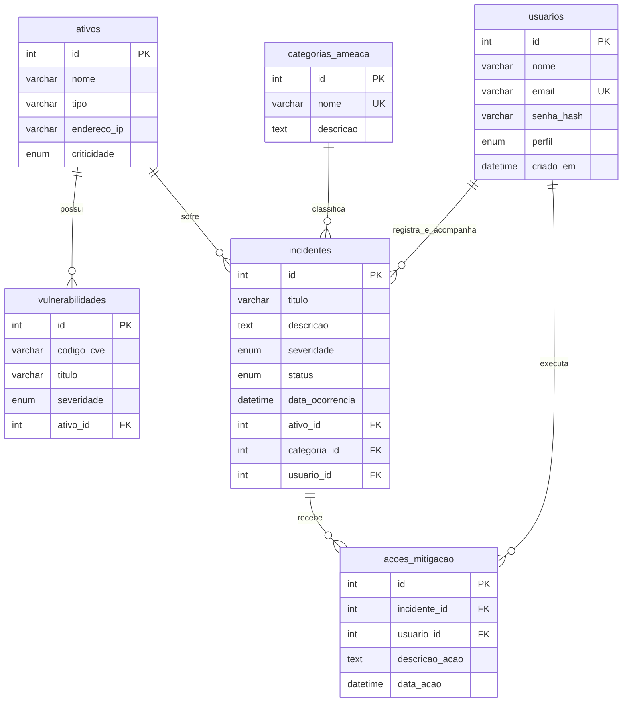

# Modelo Entidade-Relacionamento (MER) — Mini-SOC

O diagrama abaixo representa as 6 tabelas do banco de dados `mini_soc` e seus relacionamentos de chave estrangeira (`FOREIGN KEY`) implementados em `sql/01_schema.sql`.

## Resumo dos Relacionamentos

- **1:N (`ativos` -> `vulnerabilidades`)**: um ativo monitorado pode possuir várias vulnerabilidades (CVEs); cada vulnerabilidade pertence a um ativo (`ON DELETE RESTRICT`).
- **1:N (`ativos` -> `incidentes`)**: um ativo pode estar envolvido em vários incidentes; cada incidente afeta um ativo (`ON DELETE RESTRICT`).
- **1:N (`categorias_ameaca` -> `incidentes`)**: uma categoria de ameaça classifica vários incidentes (`ON DELETE RESTRICT`).
- **1:N (`usuarios` -> `incidentes`)**: um analista pode ser responsável por vários incidentes (`ON DELETE RESTRICT`).
- **1:N (`incidentes` -> `acoes_mitigacao`)**: um incidente pode receber múltiplas ações de mitigação; ao excluir um incidente, suas ações vinculadas são removidas em cascata (`ON DELETE CASCADE`).
- **1:N (`usuarios` -> `acoes_mitigacao`)**: um analista pode registrar diversas ações de mitigação (`ON DELETE RESTRICT`).
